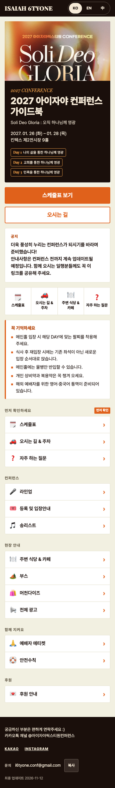
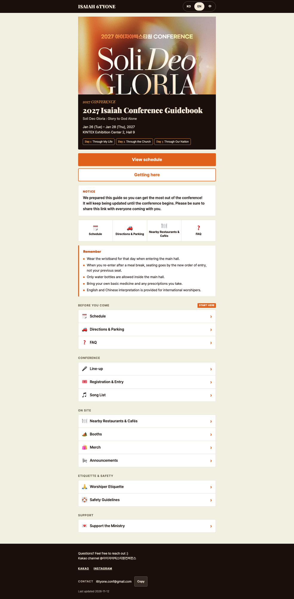
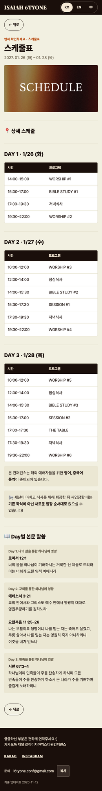
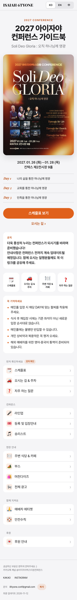
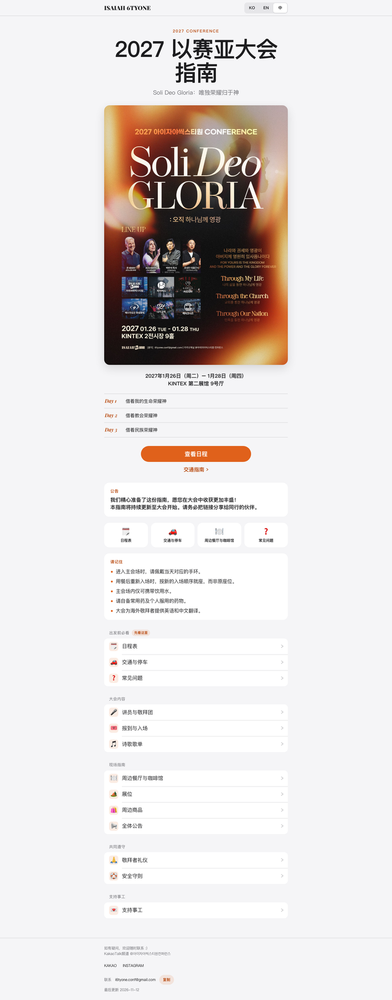
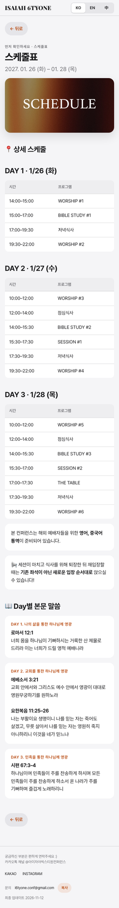
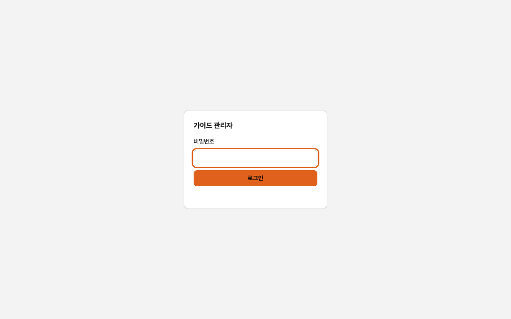
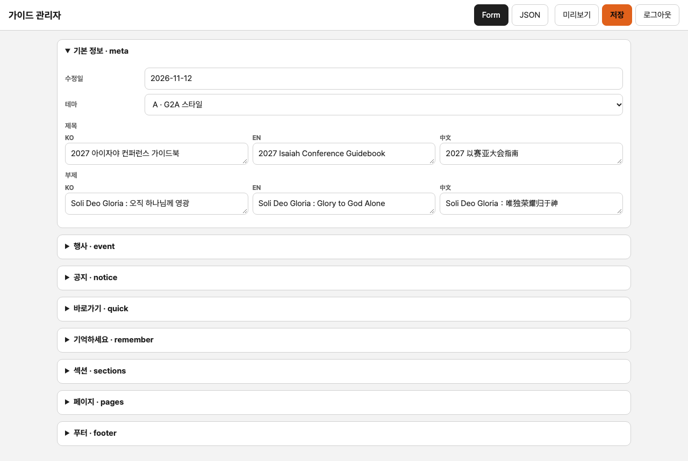

# 2027 아이자야 컨퍼런스 가이드 — 작업 보고서

작성일: 2026-11-12. 저장소 `~/isaiah61-guide`의 로컬 git 커밋만 있고, push와 배포는 하지 않았습니다.

## 한눈에 보기

| 항목 | 결과 |
|------|------|
| 가이드 사이트 | `npm start` → http://localhost:3061 |
| 언어 | KO / EN / 中. 상단 버튼으로 바꾸고, 선택한 언어는 다음 방문 때도 유지됩니다 |
| 관리자 | http://localhost:3061/admin. 비밀번호는 `npm run set-password`로 정합니다 |
| 디자인 | A안(G2A 모방)이 기본이고, B안(애플 스타일)은 `?theme=apple`로 봅니다 |
| 내용 | 노션 가이드북 13개 페이지를 모두 옮겼고, 영어·중국어 번역을 넣었습니다 |
| 모바일 | 320px, 390px, 1280px에서 확인했고 가로 스크롤이 생기지 않습니다 |
| 의존성 | npm 패키지 0개(Node 기본 모듈만 사용), 빌드 단계도 없습니다 |
| 테스트 | `npm test` 5개 통과(로그인·세션 만료·내용 검증·경로 침입 차단·로그인 횟수 제한) |
| 결정이 필요한 질문 | `QUESTIONS.md` Q1–Q9. 모두 기본값으로 먼저 진행했습니다 |

## 단계별 진행과 선택한 안

| 커밋 | 한 일 | 선택한 안 |
|------|-------|-----------|
| dd005fa | 기획 문서(SPEC·DESIGN·PLAN)와 질문 목록, 초기 내용 | 노션을 1회 복사하고 이후에는 이 사이트를 원본으로 씀(Q4) |
| df07c38 | 서버, 관리자 로그인, 내용 저장(검증·백업 20개), 테스트 | 외부 패키지 없이 Node 기본 모듈만 사용. 공용 비밀번호 1개(Q3) |
| 5280d41 | 가이드 화면(홈·상세), 언어 전환, A안 디자인 | G2A 사이트 구조를 따르고 색은 포스터에서 가져옴 |
| 5001977 | 관리자 편집기(폼 편집·JSON 편집·저장) | 모든 글을 KO/EN/中 세 칸으로 나란히 편집 |
| ad6f080 | B안 애플 스타일 디자인(라이트/다크 모드) | 같은 화면 구조에 스타일만 다르게 입힘 |
| 33d12fc | 노션 원본 14개 페이지 텍스트·스크린샷 보관 | 참고 자료로 `docs/reference/notion/`에 둠 |
| 5749be6 | 실제 노션 내용을 KO/EN/中으로 반영, 이미지 23MB → 4.2MB | 시간표는 표로, 자주 하는 질문은 펼치기 목록으로 |
| b22cc75 | 두 디자인 × 세 언어 × 모바일/PC, 관리자 화면 QA 스크린샷 | – |

## 화면

### A안 (G2A 스타일, 기본)

### B안 (애플 스타일)

### 관리자

나머지 스크린샷(오시는 길·식당·라인업, 언어별 화면)은 `docs/screens/qa/`에 있습니다.

## 알려진 한계와 다음 단계

- **배포 전입니다.** 호스팅(Q2)과 도메인(Q9)이 정해지면 배포합니다. Vercel 같은 서버리스는 파일 저장 방식을 바꿔야 해서 Render·Fly·교회 서버를 권합니다.
- **번역 검수가 필요합니다.** 영어·중국어는 기계 초벌 번역입니다. 고유명사와 교회 용어는 원어민 확인을 권합니다(Q5).
- **이미지 업로드는 없습니다.** 새 이미지는 `public/assets/`에 넣고 관리자 화면에서 경로만 입력합니다(Q6).
- **관리자는 공용 비밀번호 하나입니다.** 누가 고쳤는지는 남지 않지만, 저장할 때마다 이전 버전이 백업됩니다(Q3).
- **노션과 자동 동기화하지 않습니다.** 앞으로는 관리자 화면에서 고칩니다(Q4).
- **디자인은 A/B 중 하나를 골라 주세요(Q1).** 관리자 화면의 "테마"에서 바로 바꿀 수 있습니다.
